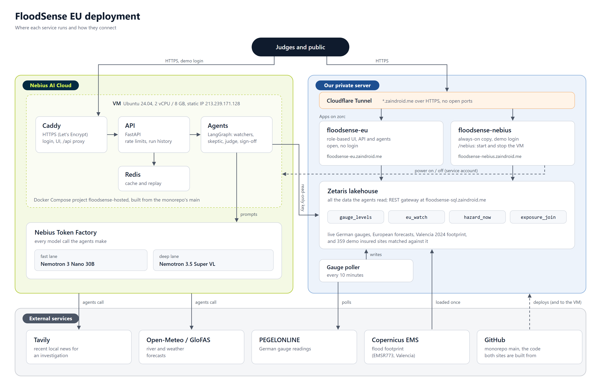

# FloodSense EU

FloodSense EU tells a citizen, an insurer or a civil-protection officer whether a place in Europe
is at flood risk, and why. Each sentence in an answer comes with a source: a Zetaris query, a
document passage or an approved memory. A team of agents investigates the harder questions. A
Skeptic challenges the findings, and a Judge scores each claim against its evidence. No alert or
notice goes out until a person approves it.

Every model call goes to **NVIDIA Nemotron on Nebius Token Factory**.

Entry for the **Nebius x NVIDIA Global AI Hackathon**, track Best Apps and Agents.



## Try it

| | |
|---|---|
| Live app | **https://floodsense-nebius.zaindroid.me** |
| Login | `demo` / `test123` (keeps the Token Factory credit for judges) |
| Same app on Nebius AI Cloud | Open https://floodsense-nebius.zaindroid.me and press **Open on Nebius**. The VM sleeps to save credit. It wakes in about a minute and the app opens on its own. |

A short tour:

1. Pick a role in the header: **Citizen**, **Insurer** or **Civil protection**. The pages and the
   wording follow the role. The facts stay the same.
2. **Watch** shows 45 European rivers and places with live gauge readings, on a 3D map.
3. **Ask**, as Insurer: *"Why are our Valencia sites at risk?"* This runs the full agent team
   against the October 2024 Valencia flood. It takes a few minutes, and you can follow each agent
   live.
4. **Decide** lists the actions the agents propose, such as adjuster visits and policyholder
   alerts. Nothing goes out until you approve it.

Simple questions such as *"Is the Rhine at Köln rising right now?"* come back in a second or two,
straight from data, with no model call.

## How it uses Nebius and NVIDIA

- **Nebius Token Factory** serves every chat completion through one OpenAI-compatible API:
  - The fast lane runs `nvidia/NVIDIA-Nemotron-3-Nano-30B-A3B`, served in Finland. It handles the
    investigator, the Skeptic and the first drafts.
  - The deep lane runs `nvidia/Nemotron-3.5-Super-VL`. It handles the Judge's grounding checks and
    repairs.
  - Each answer records which model gave it, plus its tokens and cost.
- **Nebius AI Cloud** runs the same app on a VM (2 vCPU, 8 GB, Ubuntu 24.04). It runs as Docker
  Compose services: a Caddy proxy with HTTPS, the API, the agents and Redis. This site starts and
  stops the VM through a service account that can only power that one VM on and off. The VM
  sleeps again after 120 minutes.
- **Zetaris** is the only way the app reads data. The agents query its views:
  - live German gauge levels (PEGELONLINE, updated every 10 minutes)
  - European river forecasts (Open-Meteo, GloFAS)
  - the Copernicus EMS flood footprints
  - 359 synthetic insured sites matched against the footprint
- **Tavily** adds recent local news to an investigation. It is labelled as web context and never
  used for numbers.

## This repository

This is the deploy copy of the team monorepo,
[FloodSenseEU-Hackathon-Monorepo](https://github.com/GenAI-Open-Agent-Hackathon/FloodSenseEU-Hackathon-Monorepo).
Everything except `serve/` is copied unchanged from its `main`. `/version` on the live site shows
the commit.

| Folder | What it is |
|---|---|
| `agents/` | LangGraph agents: router, watchers, investigator, Skeptic, Judge, playbook, approval |
| `api/` | FastAPI: runs, live streams, approvals, watch status, Zetaris views |
| `ui-merged/web/` | The role-based web UI with the 3D map, served at `/app/` |
| `engines/`, `contracts/` | Memory and world-model engines, shared data contracts |
| `serve/` | What this copy adds: the login, the start page and the Nebius VM controls |

What `serve/` adds:

- `login.py` puts one login in front of the app, so no stranger can spend the Token Factory credit.
  `/health`, `/ready` and `/version` stay open.
- `nebius.py` and `nebius.html` make the start page and `/nebius/api/{status,start,stop,extend}`.

## Run it yourself

Set these on the host, never in the repo:

- `LLM_BACKEND=nebius` and `NEBIUS_API_KEY`
- `ZETARIS_REST_URL`, `ZETARIS_API_KEY` and `FF_LIVE_DATA`
- `JUDGE_PASSWORD`
- optionally `TAVILY_API_KEY`
- for the VM controls, `NEBIUS_INSTANCE_ID` and `NEBIUS_DEMO_URL`, plus either
  `NEBIUS_SA_CREDENTIALS` or all three of `NEBIUS_SA_ID`, `NEBIUS_SA_PUBLIC_KEY_ID` and
  `NEBIUS_SA_PRIVATE_KEY`

```sh
docker build -t floodsense-nebius .
docker run -p 8080:8080 --env-file .env floodsense-nebius
```

Tests for `serve/`: `python -m unittest serve.test_nebius_front` (needs `fastapi`, `httpx`, `nebius`).

## Notes

- The insured sites are synthetic, and the risk figures come from a model. Neither is an official
  warning.
- The fast lane runs in the EU. The deep lane model is listed in the US, so we do not claim
  EU-only inference.
