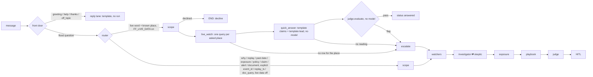
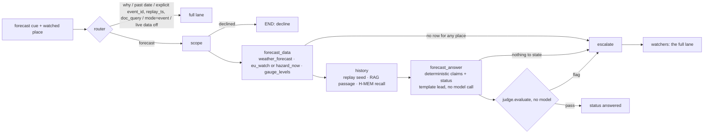

# Agents

Purpose: the LangGraph runtime. Graph: **Watchers → Investigator → Skeptic → Exposure → Playbook → Judge → human-in-the-loop interrupt**, as planned. Agents read data only through Zetaris (`zetaris.py`, SELECT-only) and call models only through the Nightshift client (`nightshift.py`, pinned lanes).

Owner: Ayush (Nightshift client, H-MEM, World Model, memory, embeddings) and Zain (graph, HITL, Judge with Mihir).

```
watchers → investigator → skeptic ─┬─ not_supported, first time → revise → investigator → skeptic
                                   └─ → exposure → playbook → judge ─┬─ flagged, first time → playbook (repair) → judge
                                                                      └─ → hitl (interrupt) → learn → end
```

With `ENGINES_URL` set, the Watchers, Investigator and Skeptic also write to the World Model board, and behind `FF_HMEM` the Investigator recalls past approved findings and Learn stores the approved run. See [Engines: memory and World Model](#engines-memory-and-world-model).

| Node | Lane | What it does | Owner |
| --- | --- | --- | --- |
| `nodes/watchers.py` | SQL | Anomalies from `hazard_timeline` in the event window, cut at `replay_ts`; reads `gauge_levels` for that window when the event lists stations; loads `provenance` | Zain, Ayush |
| `nodes/investigator.py` | fast | Hypotheses H1–H3 (rain→catchment→river→site) backed by claims; every claim cites a `query_id` (layer a) and the provenance row (layer b). Deterministic chain from aggregate queries run together; the model refines it from the same evidence on `meterless/fast` | Zain, Ayush |
| `nodes/skeptic.py` | SQL (+fast rationale) | ≤ `SKEPTIC_MAX_ROUNDS` counter-check queries per hypothesis (default 3; a smoke run can set 1) → `supported` / `not_supported`; one revise edge back to the Investigator, which drops what was not supported. The rationale is `meterless/fast` | Zain, Ayush |
| `nodes/exposure.py` | SQL | `exposure_join` with `in_footprint = TRUE`: policies, sum insured, by segment → H4 with number claims. The sample, the segment rollup, and the total run together | Ayush, Zain |
| `nodes/playbook.py` | fast draft, deep repair | Actions for 6 / 24 / 72 h citing claim ids; `outbound` ones wait for approval. The first draft is `meterless/fast`. A model action that cites no claim of this run is dropped. The repair round, when the Judge flags a claim, stays on `meterless/deep` | Ayush, Zain |
| `nodes/judge.py` | deep | Per-claim coverage, citation faithfulness, numbers match, licence, grounding → `judge[]` + `judge_summary`. Never deletes or rewrites | Zain, Mihir |
| `hitl.py` | — | `interrupt()`; approve / edit / reject; `approval{}`; outbound actions released only on approve / edit | Zain |
| `nodes/memory.py` | — | Behind `FF_HMEM`: recall before the Investigator's first pass, and the Learn node after `hitl`, which stores an approved or edited run | Ayush |
| `nodes/world_model.py` | — | With `ENGINES_URL`: writes the Watchers' anomalies and each hypothesis write to the World Model board | Ayush |

Contracts (gameplan v2 §5.5) are in `models.py` field for field: Evidence, Citation, Judge score, agent state (`run_id, thread_id, event_id, customer_id, replay_ts, anomalies[], hypotheses[], exposure{}, playbook[], judge[], approval{}, trace[]`), trace events. Extras (`claims[]`, `evidence{}`, `judge_summary`, `summary`) sit next to them and the UI may ignore them. The nodes use only the contract views (`hazard_timeline`, `discharge_daily`, `exposure_join`, `gauge_levels`, `provenance`), so switching to live is `FF_LIVE_DATA=true` plus credentials. `FF_LIVE_DATA` defaults to false and stays off until that flag is set.

Watchers query `gauge_levels` only when `events.py` lists stations for that event. EMSR517 (Ahr) lists Bonn, Köln, and Koblenz, because the Ahr joins the Rhine between Koblenz and Bonn. EMSR773 (Valencia) lists none, and the gauge query is skipped. Watchers read `hazard_timeline`, not `hazard_now`. A live PEGELONLINE pull is the last 30 days, so those rows never overlap the frozen event windows (12–16 July 2021 and 28–30 October 2024). The seed rows name the Ahr stations at `window_from_utc` and leave `level_cm` empty.

Point ids in `events.py` are the warehouse ids. Valencia is `VAL01`–`VAL08` (`ingestion/prep/valencia_points.csv`, migrations 004 and 012). Chiva is `VAL07`. Paiporta on the Barranco del Poyo is `VAL01`. Turís is not on that list. The Ahr uses `AHR01` (Altenahr) and `AHR02` (Ahrweiler), the same ids as `ingestion/feeds/feeds.py`. `floodsense_seed` hazard and discharge views are the Valencia series only, so an Ahr replay against those views still has no hazard rows. FakeZetaris uses the same ids and does carry the Ahr rows. `exposure_join.in_footprint` is boolean (`in_flood_footprint = 'yes'` in migrations 014, 016, and 018). The SQL predicate is `in_footprint = TRUE`.

## Run it

From the repo root, `python tasks.py init-env` copies `.env.example` to `.env` here when it is missing (Windows: `py tasks.py init-env`). With nothing filled in, the runtime starts on **FakeZetaris** (the contract views as SQLite seed rows for Valencia 2024 / Ahr 2021, Rhine gauge stations with no invented level, plus a synthetic portfolio) and **FakeNightshift** (deterministic), so the whole graph, the API and the UI work before credentials and live views exist. Fill `ZETARIS_REST_URL` / `ZETARIS_API_KEY` and `METERLESS_BASE_URL` / `METERLESS_RUNTIME_TOKEN` to go live.

```bash
python3 -m pip install -r requirements.txt
python3 -m unittest discover -s tests          # 20 tests, < 1 s, no network
python3 -m floodsense_agents                   # http://127.0.0.1:8100 (compose: not published; the API proxies it)
```

```bash
curl -s -X POST 127.0.0.1:8100/runs -H 'content-type: application/json' \
  -d '{"question":"Why are our Valencia sites at risk?","event_id":"EMSR773","customer_id":"demo-insurer","replay_ts":"2024-10-29T18:00:00Z"}'
# -> status awaiting_approval, hypotheses[], claims[] with citations, exposure{}, playbook[], judge[], trace[]
curl -s 127.0.0.1:8100/runs/<id>/approval
curl -s -X POST 127.0.0.1:8100/runs/<id>/approval -H 'content-type: application/json' -d '{"action":"approve","reviewer":"zain"}'
curl -N 127.0.0.1:8100/runs/<id>/events        # SSE: `started` per node, `trace` per finished step, then `status`
curl -s -X POST '127.0.0.1:8100/runs?wait=false' -H 'content-type: application/json' -d '{"question":"..."}'
# -> 202 {"run_id": "...", "thread_id": "...", "status": "running"}; the graph runs in the background
```

Live runs. `POST /runs?wait=false` returns 202 at once and runs the graph on a daemon thread; the default is still synchronous. While it runs, `GET /runs/{id}` reads each node's checkpoint as it lands (status `running`, the trace so far), and `GET /runs/{id}/events` streams `started` (`{run_id, node, phase: "started", ts}`, from LangGraph's debug stream), `trace` (a finished step: `node, phase: "finished", lane, model_id, latency_ms, duration_ms, summary, evidence_ids`) and one final `status`. `started` events exist only for background runs of this process. The run snapshot and the approval payload carry `memory_used[]` (`memory_id, run_id, claim_id, approved_at, text, relevance`): what H-MEM recalled for the Investigator. It is run level only. The memories are prompt context, never cited, so which claim leaned on which memory is not knowable and no claim is marked. Each playbook action carries optional `action_type`, `title`, `target_region`, `affected_site_count` (exact only when the exposure sample holds every policy, else null) and, for outbound actions, `draft_message`, built only from a fixed template, the region, the cited claim texts and a fixed closing line per action type (never model text). `edit` may send `draft_messages: {action_id: text}` (422 for an empty draft, an unknown or non-outbound action, or an edit that changes nothing). A background run that fails reads `failed`; it has no replay fallback.

## Chat front door

`front_door.py` runs before the graph on `POST /runs` (sync and `?wait=false`) and on `POST /front-door` (the check alone, which the API calls). It sorts a message into `greeting`, `help`, `thanks`, `off_topic` or `flood_question`. A rules pre-check decides clear cases with no model call: a bare "hi", "thanks" or "what can you do", and any flood word (river, rain, level, risk, Valencia, Ahr, 2021, ...) which always means `flood_question`. Anything else that is at most six words and names no place (no capitalised word after the first) gets one fast-lane call (`TASK: front_door`, the `meterless/fast` lane with its `LLM_MAX_TOKENS_FAST` cap); a longer message or one naming a place goes straight to the run. The call waits at most `FRONT_DOOR_TIMEOUT_S`, which defaults to the API's `CACHE_LOOKUP_TIMEOUT_S` (3 s) less 0.5 s, so 2.5 s: the agents answer before the API's lookup gives up. A failure, timeout or unknown label falls back to the rules, and an unsure rule means `flood_question`. Flood words include English, Spanish and German forms (riesgo, inundación, crecida, río, Hochwasser, Überschwemmung, Pegel, Fluss, Keller, basement, wet, water). Only the four small-talk intents return `200 {"kind": "reply", "intent", "answer", "suggestions", "model_id", "latency_ms"}` with no `run_id`; the answer is a fixed role-aware template (citizen: risk at a place and why, live river levels, past floods such as Valencia 2024 and the Ahr 2021, with sources; insurer: exposure, alerts a person approves, evidence; operator: a brief on any of the 45 watched places, upstream gauges and a script for callers) plus three example questions. The front door never states a flood fact. An explicit `event_id`, a `replay_ts`, or a `doc_query` that differs from the question (the UI mirrors the question into `doc_query`; that mirror is not explicit) always goes to the full run, so evals and e2e are unchanged. `?front_door=false` skips the check; `FF_FRONT_DOOR=false` turns it off.

`POST /runs` (`?wait=false` for 202 and a background run), `GET /runs/past`, `GET /runs/{id}`, `GET /runs/{id}/replay` (the run labelled replay, `cached_at` its start), `GET|POST /runs/{id}/approval`, `GET /runs/{id}/citations`, `GET /runs/{id}/events`, `GET /config`, `GET /health`. Every response carries `served_from` and `cached_at` when it is not live. A fresh read of `floodsense.*` through live Zetaris, with no replay clock, is `live`. Fake Zetaris, the seed schema, and a replay clock are `replay`. A re-read with no replay clock, including a cached event timeline, is `cache`. A run posted with `replay_ts` stays `replay` on `GET /runs/{id}`. `/ready`, `/config`, `/version`, `/runs/past`, an empty `/desk/events`, and `/desk/dispatch-target` are `replay` on FakeZetaris or the seed schema. `GET /health` is liveness only and may say `live`.

The product UI is the Vite console in `ui/` (compose publishes it on `127.0.0.1:15173`). This service does not serve `ui/app` or `ui/mock`. `GET /` and `GET /console` serve `console.html`, a secondary operator page on this unpublished port.

**Replay schema.** An event replay reads `hazard_timeline` and `discharge_daily` from `EventSpec.hazard_schema` when set, whatever `FF_LIVE_DATA` says (`events.hazard_schema`). EMSR517 sets `floodsense_seed`: the live `floodsense` hazard views hold Valencia only, and the real Ahr extract (ERA5 hourly rain, GloFAS daily discharge, migrations 051/052) is in the seed. `exposure_join`, `gauge_levels` and `provenance` keep the configured schema. `GET /views/{name}?event_id=…&source=replay` serves the same rows to the UI (hazard views only, filtered to the event's point ids, `x-schema` / `x-source` headers). Rain thresholds: the Watchers flag an hour >= 30 mm or a window total >= 50 mm; the Skeptic's rain check passes on an hour >= 20 mm or a window total >= 50 mm, because ERA5 smooths the Ahr storm to 5.6-18.5 mm/h. A check that cannot apply (a warning check on a view with no warnings) is recorded as `skipped:` in the rationale and is not support; a hypothesis whose checks were all skipped stays `proposed`. A model claim keeps every number that is a cell of its cited rows; one that is not is dropped only when each mention in the text is a date or clock part, a declared line named in its unit after a comparison word ("above the 100 m3/s line"), or the coordinate filter of the cited SQL, and the drop is recorded on `Claim.numbers_dropped`. A claim whose numbers were all dropped is unverified in the Judge (numbers_match false).

`replay_ts` is the "now" of a replay: the Watchers and the Investigator only see rows at or before it, so the demo can step through 29 Oct 2024 hour by hour.

## Router agent and lanes

The front door above is the router's `reply` lane. A message that reaches a run is routed by `router.py` in `Runtime._prepare` to one of three run lanes (quick, forecast, full; the forecast lane has [its own section](#forecast-lane)), and the choice is on the snapshot (`lane`, `router_reason`) and is the first trace entry (`{node: "router", summary: "chose quick: live level question about KÖLN"}`), so the UI pipeline and `GET /runs/{id}/events` show it.



- **Rules first.** A deep word (why, explain, replay, happened, past, exposure, policy, claim, insured, sites, alert, draft, document, report, bulletin, evidence ...) or a past date (`live.classify`) means `full`. A live word (now, today, current, level, how high, rising, falling, next 48 hours, jetzt, Pegel, ahora ...) plus a known place means `quick`. Places are `watch.watch_target` (cities, rivers and stations of the Europe live watch, PR #78) and the router's `PLACES`, built from `watch.place_words()`, `watch.STATIONS`, the event vocabulary and the point names (not a copied list; "Main", "Ems", "Oder", "Po" count only through `watch_target`). A live word or a place alone is ambiguous and asks the fast lane once (`TASK: router`, `{"lane": "quick" | "full"}`, the front door's deadline, on the router's own two-worker pool so a timed-out call never holds a front-door worker). A failure, a timeout or a bad label means `full`.
- **Always full:** an explicit `event_id`, `replay_ts` or a `doc_query` that differs from the question (the front door's rule, so the evals keep their path), `mode=event`, `FF_QUICK_LANE=false`, and `FF_LIVE_DATA` off (the seed schema holds no present, so the quick lane never answers "now" from it).
- **Quick lane** (`nodes/quick.py`). Scope runs first; a decline ends the run and is never overridden. `live_watch` resolves the asked places (`watch_target`: a city first, then a river, then the selected station or watch point; otherwise the event's point names in the question, else all its points; at most six) and reads one Zetaris query per place in parallel: `live.gauge_latest_sql(schema, stations=(station,))` for a gauge, `{schema}.eu_watch WHERE point_id = '<id>'` for a GloFAS point, and a `hazard_now` past/forecast summary `WHERE point_id = '<id>'` for an event point. A row counts only when its `station`, or its `point_id` plus `name` and `river`, is that place's; only those queries become evidence. `quick_answer` builds one claim per place from that place's row with a fixed template (gauge: level with its measurement time and "stale" when older than `GAUGE_STALE_H`, band against the station's MHW when the view has it (above; near = at least 80% of MHW, FloodSense's own cut and not an official threshold; below), trend against the reading about three hours earlier; eu_watch: the model cell value today, the forecast maximum against the past-30-day median, and the band, labelled model; hazard_now: forecast maximum discharge and rain). Each claim cites only its own place's query, and `claim.numbers` are cells of that row. The summary is a template too: one lead line per place, worst band first (e.g. "KÖLN: above mean high water and rising (gauge, 12:45 UTC)"), then the claim texts. The quick lane makes no model call; the Nemotron fast lane is used only by the router for ambiguous messages. The Judge step is `judge.evaluate` with no model, so it checks per claim: at least one citation, its cited query returned rows without error, and every number in `claim.numbers` is a cell (or a column sum) of the cited rows within `NUMERIC_TOLERANCE`; any claim failing one of these is flagged. A pass ends the run with `status: "answered"`, no Playbook and no approval (`approval.status` stays `not_reached`). With fakes it runs in milliseconds; live it is the parallel Zetaris reads only, about 1-3 s (plus up to the router's 2.5 s fast-lane call when the message was ambiguous).
- **Escalation.** No row for any asked place, no reading in the rows, or any Judge flag sends the same run on to `watchers` and the full lane. The `escalate` node sets `lane: "full"`, appends `; escalated: <why>` to `router_reason` and adds `{node: "router", summary: "escalated: judge flagged Q1; running the full lane"}` to the trace. A run whose scope declined is never escalated into the full lane; it ends with the decline.
- **Cache.** The API caches a quick answer that the Judge passed with `CACHE_TTL_LIVE_S`; a repeat is `served_from: "cache"`, labelled "Cached answer ... not live" (see `api/README.md`). `FF_QUICK_LANE` is in the agents' `/config` flags, so it is part of the cache fingerprint.

## Forecast lane

"Do the next 48 hours look safe at Köln?", "Will the Danube at Budapest rise this week?", "¿Lloverá en Valencia mañana?". `nodes/forecast.py`, router lane `forecast`, for the 45 watched places of `watch.FORECAST_POINTS`: the 26 PEGELONLINE gauges (PEG01-PEG26), the 11 GloFAS `eu_watch` points (EU01-EU11) and the 8 Valencia points (VAL01-VAL08).



- **Routing.** After the deep words and past dates (still `full`), a forecast cue (next N hours/days, coming days, tomorrow, this week, forecast, outlook, will … rise/flood, look safe; German morgen, übermorgen, nächste, Vorhersage; Spanish mañana, próximos, pronóstico, previsión) plus a place `forecast_places()` resolves picks `forecast`; a present question ("How high is the Rhine at Köln?", "Is the Danube at Budapest rising?") stays `quick`. Places: `watch.watch_target` (a city first, then a river), then the Valencia town names, "Valencia" alone (VAL01 Paiporta and VAL07 Chiva, the event's river and rain points), then the selected station or point; at most three. An explicit `event_id`, `replay_ts`, `doc_query`, `mode=event`, `FF_FORECAST_LANE=false` and `FF_LIVE_DATA` off always mean `full`, so the evals keep their path (a test routes every eval item).
- **forecast_data** (SQL). One `run_sql_parallel` batch for all asked places: `{schema}.weather_forecast` (`lead_h < 48` sum, the 72 h sum and the wettest hour; Open-Meteo, DWD ICON `icon_seamless`, migrations 070-072), the river forecast (`eu_watch` row for an EU point: today, the 7-day forecast maximum and the past-30-day median; the `hazard_now` past/forecast summary for a Valencia point), and the gauge (`live.gauge_latest_sql`: level, MHW, `trend_cm_h`). PEGELONLINE gauges have no discharge forecast in FloodSense; the answer says so instead of inventing one. A row counts only when it is that place's.
- **history** (SQL + RAG + H-MEM, in parallel, `FORECAST_HISTORY_TIMEOUT_S` 10 s each). For a Valencia point (EMSR773) or a gauge on the Rhine, Mosel, Saar, Main or Neckar (EMSR517: the Ahr joins the Rhine), one aggregate of `floodsense_seed.hazard_timeline`: the 48 h rain before the end of the peak day (Ahr: 13-14 Jul 2021 at AHR01 Altenahr; Valencia: 28-29 Oct 2024 at the asked point) and the event window's peak modelled discharge. The top verified RAG passage (`retrieve_docs("<place> flood: <event name>, rain before the peak", 2, {event_id})`, `FF_RAG_DOCS`). H-MEM recall for the place (`Deps.memory.recall`, `FF_HMEM`); only a memory that names the place, its river or its gauge is kept, and a `tasks.py demo-seed` memory is labelled "demo seed". Places outside those basins (Budapest, Dresden) get no past pattern.
- **forecast_answer.** No model call. Deterministic claims, one per evidence item, each citing only its own evidence: F-rain (`weather_forecast`), F-river (`eu_watch` / `hazard_now`), F-level (`gauge_levels`), F-pattern ("Past pattern: before the July 2021 Ahr flood, rain over 48 hours (13-14 Jul 2021) reached 78 mm at Altenahr and modelled discharge peaked at 249.61 m3/s ...; the forecast for the next 48 hours at KÖLN is 1.5 mm (a comparison, not a prediction for KÖLN)", citing the seed query and the forecast query), the passage (layer c, quote-verified), and the memory (cites the recall, recorded as `hmem.recall` evidence, labelled "context from an earlier run, not a measurement"). **Status** is FloodSense's own screening with fixed cuts, never official and never driven by the past pattern: Elevated when the 48 h rain reaches 50 mm (`anomaly_rain_total`) or an hour 30 mm (`anomaly_rain`), the gauge is at or above MHW, the `eu_watch` band is above, or a Valencia point's forecast discharge reaches 100 m3/s; Watch at 25 mm / 20 mm per hour, near MHW (80 %) or band near; else Normal. The lead is a template, the status line, built from the same data (as in the quick lane); the summary is the lead, the claim texts, any gap, and "This is a model-based screening, not an official warning; follow <national service>" (DWD and the Hochwassermeldedienst; AEMET and Protección Civil; Vigicrues; HungaroMet and OVF; ...). The run carries `forecast {status, status_reason, places, horizon_h, lead, screening, gaps, disclaimer, attribution}`.
- **Judge and escalation.** `forecast_judge` is `quick.quick_judge`: `judge.evaluate` with no model; a pass ends `answered` with no Playbook and no approval. No row for any place, nothing to state, or any flag escalates the same run to `watchers` with `escalated: ...` on the trace, as the quick lane does.
- **Cache.** The API caches a passed forecast answer like a quick one, with `CACHE_TTL_LIVE_S`. `FF_FORECAST_LANE` is in `/config` flags, so it is part of the cache fingerprint.
- **Cost and latency.** The weather forecast is read with one `WHERE point_id IN (...)` query for all asked places (at most three), because every Zetaris query re-fetches the whole 45-location Open-Meteo REST table: that is about 45 Open-Meteo calls per question, not per place. `eu_watch` and `hazard_now` reads add their own Flood/forecast API fetches (11 and 8 locations). With no model call the lane takes about 3-4 s against the local stack (27 Oct 2026: `forecast_data` 1.7-2.6 s, `history` 0.02-1.3 s, Judge under 0.2 s). A repeat of the same question is served from the API cache.

## Control tower: the watch loop

`tower.py`. The product looked reactive; this makes the agents visibly work on their own. A background thread (started at app startup; `FF_WATCH_LOOP=false` turns it off; `WATCH_INTERVAL_S`, default 900) scans, with **no model calls**:

1. Reads `gauge_levels`, `eu_watch` and `hazard_now` through the Zetaris client (three parallel reads, 45 sources) and gives each source the plain status of `ui/src/lib/places.ts` `statusView`: a gauge by the view's band against its MHW (a stale reading is "unknown" and never an event), a model point by the `eu_watch` band, a Valencia point by the higher of the latest hour and the 48 h forecast maximum against the 20 / 80 m³/s demo lines. Never red, never "Warning".
2. Diffs against the previous scan (kept in `watch_state.json`, so a restart does not re-announce). A source that is newly elevated (near or above) or escalated (near to above) gets, in order: `detected` (Watch), `checked` (Forecast), and, for a Valencia point or one within 25 km of the demo book, `exposure` (Exposure). A return to normal is an `info` event. A view that cannot be read keeps its sources' last status and is one `info` note.
3. The forecast check is the forecast lane's own logic without a graph run (`nodes/forecast.py`: `weather_sql`, `level_claim`, `river_claim`, the fixed 25 / 50 mm and 20 / 30 mm cuts). One `weather_forecast` query serves every raised place; the river forecast and the gauge level come from the rows the scan already read. It records the 48 h rain, the wettest hour, the forecast maximum and the screening. The screening word is the lane's `Elevated` (the status set is Normal / Watch / Elevated).
4. Exposure is one aggregate over `exposure_join` (distinct sites and summed insured value in a ±25 km box); raised points less than 10 km apart share one read ("also covering ..."). The demo book is synthetic and covers Valencia only.
5. **Auto-assess**, `FF_AUTO_ASSESS` (default off, also a runtime switch, `POST /watch/auto-assess`): the single most severe new source of a scan may start one full run through `Runtime.start_async` with the context `{role: insurer, page: control-tower, auto: true}` and a fixed question ("Assess the flood risk to our insured sites near ..."; "insured sites" sends it to the full lane). At most `WATCH_AUTO_PER_HOUR` (1) per hour and `WATCH_AUTO_PER_DAY` (3) per day, kept in `watch_state.json` across restarts. The run lands in the approval queue as usual; nothing here approves anything.

**Open-Meteo budget.** The free tier allows about 10,000 location-calls a day, and a request for N locations counts N. Each scan reads `eu_watch` (11 locations) and `hazard_now` (8) from the Open-Meteo Flood API through Zetaris, which re-fetches them per query (gauges come from the PEGELONLINE file store, no Open-Meteo): about 19 location-calls a scan, so 96 scans a day at 900 s is about 1,800 a day. A scan that raises a new or escalated source adds one `weather_forecast` query of 45 locations; a scan with nothing new makes no weather query (tested), so a steady world costs only the baseline. A manual "Scan now" costs the same 19 (and is limited to one per 5 s here and `WATCH_CYCLES_PER_MIN` at the API). The UI's own live reads of the same views come on top. Shorten the interval only with this budget in mind.

**Safety of the switch.** The first scan after a first-ever start (no `watch_state.json`) only learns what is raised and never auto-assesses. The cap is counted and saved before the run starts, so a crash cannot forget it (a start that fails gives it back). Without a state file the caps could not survive a restart, so auto-assess fails closed: with `CHECKPOINTER=memory` or an unwritable `WATCH_DATA_DIR`, `FF_AUTO_ASSESS=true` is ignored, `POST /watch/auto-assess` with `enabled: true` is a 409, and `/watch/status` reports `persisted: false` with `persisted_reason` (the UI shows it). `POST /watch/auto-assess` needs the header `x-watch-admin-token` when `WATCH_ADMIN_TOKEN` is set (agents and API both check it; reading the feed never needs it). **Set it on any machine that is not a dev box.** The UI sends it only when `VITE_WATCH_ADMIN_TOKEN` is set; that value ships to the browser, so it is a speed bump, not a secret.

Run lifecycle: `Runtime.observers` (`fn(kind, run_id)`, `paused` and `resumed`, never able to break a run) feed the tower. A full run that reaches the interrupt adds `drafted` (Playbook) and `awaiting_approval` (Judge); an approve or edit adds `approved` (Human), a reject an `info` row by the Human. A quick or forecast answer adds nothing.

**Events** (`contracts` `watch_event`): `{id, ts, kind, agent, place_id, place, river, country, status, tone, text, run_id, source: {view, query_id}, data}`. `id` is `w` plus an 8-digit, strictly increasing number. Kinds: detected, checked, exposure, drafted, awaiting_approval, approved, info; agents: Watch, Forecast, Exposure, Playbook, Judge, Human. `text` comes from fixed templates and the rows read; `data` holds the same numbers. The ring holds 500 events and is mirrored to `watch_events.jsonl` in `WATCH_DATA_DIR` (default `CHECKPOINT_DIR/watch`; none with `CHECKPOINTER=memory`), reloaded and compacted on start.

Routes: `GET /watch/events?since=<id>&limit=N` (oldest first; no `since` gives the newest N), `GET /watch/stream` (SSE `event: watch`, `id:` per event, `Last-Event-ID` or `?since=` resumes, a keep-alive comment every 15 s, one connection lives 15 min; at most 20 open at once, then 429), `GET /watch/status` (loop, last scan, counts, awaiting run ids, auto-assess switch and caps; contract `watch_status`), `POST /watch/cycle` (one scan now: `202` at once with the status, the scan runs on a thread and its events arrive in the feed; 429 inside 5 s of the last one; a running scan is reported, not queued), `POST /watch/auto-assess {enabled}`. `GET /config` carries `watch: {FF_WATCH_LOOP, interval_s, FF_AUTO_ASSESS, auto_assess_per_hour, auto_assess_per_day}`, deliberately not under `flags` (the flags are the API cache key and the switch moves at runtime).

Measured on 27 Oct 2026 against the real Zetaris from a host process: 45 sources in 18 s for the first scan (13 elevated: Loire, Meuse, Vistula, Seine, Po as elevated model points, Rhone, Vltava, Tisza and five Valencia points above the 20 m³/s demo line), 1 s for a repeat.
### The calm answer (`plain`)

The quick and forecast lanes add a `plain` object next to their claims and summary, for a worried reader (`plain.py`; no model call; the claims, the Judge and the `summary` text are unchanged). Fixed rules over the statuses the lane computed:

- **headline.** Normal: "Nothing alarming expected at <place>." Watch or elevated: "Keep an eye on <place>: <the one reason in plain words>." A gauge at or above mean high water: "Water is high at <place>. Follow official warnings." A calm headline needs every computed status Normal and complete data (each asked place has the rows its question needs, no stale gauge, no gauge without a threshold, no unknown model band). Otherwise: "We can't fully check <place> right now." A worrying status always wins over a gap, and a gauge above mean high water still names another asked place that a model band elevates. The forward-looking "Nothing alarming expected" needs a rain or river forecast signal; a quick-lane gauge reading alone says "<Place> is at a normal level right now." with "This is today's reading, not a forecast." A gauge row with a missing or unreadable `ts_utc` counts as stale. Rain is always "over the next two days" (the 48 h total), never "this week".
- **one_line.** One plain sentence with the reason and the horizon ("The Danube at Budapest is expected to stay within its normal range this week and no significant rain is forecast over the next two days."). A number appears only when a cited claim states it (the quick lane's gauge level in cm); no decimals, no m3/s.
- **horizon.** `7d` when the question says "this week", "next days", "rest of the week", "nächste Woche", "esta semana" (and next 3 to 7 days), answered from the 7-day GloFAS river forecast of `eu_watch`; otherwise `48h`. A week question for a place with no 7-day river data (a PEGELONLINE gauge, a Valencia point) keeps `48h`, is never calm, and says "We only have a two-day outlook ...".
- **context.** One history item framed as history: a recalled memory that quotes a document, else the past pattern (July 2021 Ahr or October 2024 Valencia), else the document passage, else an earlier memory. It names its source, says "demo seed" when seeded, and is cut at a sentence boundary, never mid-word. The `[doc ...]` marker is removed.
- **next_step, service, country, disclaimer, details.** "Ask me about another place or open the official warnings.", the country's official service (the `OFFICIAL` table of `nodes/forecast.py`; the UI picks the links from its `WARNING_LINKS` allowlist by `country`), "Model-based check, not an official warning. Follow <service>.", and the claim ids that stay as the cited detail.
- **memory_used.** The forecast lane puts the memories its claims cite into the run's `memories`, so the Memories panel lists them (labelled seeded when seeded) instead of "No approved memories matched". Memory texts longer than 200 characters are cut at a sentence boundary.

`status` (`normal`/`watch`/`elevated`/`unknown`) and `basis` (`gauge`/`model`) let the UI pick the existing status chip. Contract: `plain` in `contracts/schemas/floodsense.schema.json`. Tests: `agents/tests/test_plain.py`.

## Nebius Token Factory backend

`LLM_BACKEND=nebius` swaps the transport for `NebiusClient` (`nightshift.py`): `POST $NEBIUS_BASE_URL/chat/completions` (default `https://api.tokenfactory.nebius.com/v1`, Bearer `NEBIUS_API_KEY`) on `NEBIUS_MODEL_FAST` / `NEBIUS_MODEL_DEEP` (NVIDIA Nemotron ids). Retry, 429 backoff and the JSON-mode downgrade are shared with the Nightshift client. A missing key fails at startup. `GET /config` and `/ready` show `llm_backend`. Default is `nightshift`. Offline tests only (`tests/test_nebius.py`); live calls are unverified, and so are the default Nemotron ids (checked against Nebius web pages, not `GET /v1/models`) and `response_format: json_object` support (a 400 naming it drops the field). `enable_thinking` is not sent, so hidden reasoning may eat `max_tokens`. The default Nebius ids are in the contract `model_id` enum, so Judge scores keep them. Logs and the unavailable error stay Nightshift-worded in the info lines; the final error says `Nebius`.

### Nebius evidence: lane check, usage, pacer

- **Lane check.** `python tasks.py check-llm` (or `POST /llm/check` on the agents) sends one tiny completion per lane and prints `ok`, the model id that answered, `nemotron` (true when that id names Nemotron) and `latency_ms`. Exit 1 if a lane fails or answers off-Nemotron. The last result shows in `GET /config` (`llm_check`, null until run) and `GET /platform/status`. It spends a few tokens. Live behaviour is unverified: tests use `httpx.MockTransport` only.
- **Usage.** Each reply's OpenAI `usage` is added per (lane, model id): to the run (`usage` on the run result and `GET /runs/{id}`; in agents memory, lost on restart, not in the checkpoint) and to a process total (`llm_usage` in `GET /config` and `/platform/status`: calls, tokens, avg latency per lane). Set `NEBIUS_PRICE_PER_M_INPUT` and `NEBIUS_PRICE_PER_M_OUTPUT` (USD per 1M tokens, unset by default; set both) and `cost_usd` is an estimate; otherwise `cost_usd` is null and `price_note` says "price not configured". No prices are built in. The Router's call counts; calls from a thread that lost the run context count only in the process total.
- **Pacer.** With `LLM_BACKEND=nebius` the process-wide gate uses `NEBIUS_RPM` (default 60 starts/min) and `NEBIUS_MAX_CONCURRENCY` (default 4); the Nightshift backend keeps `NIGHTSHIFT_RPM` (35) and `NIGHTSHIFT_MAX_CONCURRENCY` (3). The Nebius defaults are a guess, not a documented limit. `NEBIUS_RPM=0` turns pacing off.

## Nightshift speed and retries

Measured on Nightshift with Nemotron 3.5 Lightning 30B A3B (the model behind both lanes in every call recorded on 27 Oct) at about 60 to 70 completion tokens/s, and most completion tokens are hidden reasoning even with `enable_thinking=false`, so latency follows token count. Long generations get a **502 from the gateway at about 45 s**.

- Retry policy (`nightshift.py`): a reply with `finish_reason: length` is an error and is not retried, so a truncated reply never reaches a parser or the Judge. A 429 waits `Retry-After` seconds (at most 10). A timeout (`LLM_TIMEOUT_S`, 180) or an error that arrives after `LLM_SLOW_FAIL_S` (20 s) is final, and the node falls back to its deterministic path. Other errors (fast 5xx, connection, a 200 with no `choices`) get `LLM_MAX_ATTEMPTS` (2) tries in total.
- Rate limits and backoff. NVIDIA's free tier allows 40 requests/min per key, and Nightshift reports a hit as a 502 `provider_error` with `nvidia_429` in the body. Every Nightshift call (nodes, front door, router) passes one process-wide gate: at most `NIGHTSHIFT_MAX_CONCURRENCY` (3) calls in flight, and call starts paced to `NIGHTSHIFT_RPM` (35) per minute (evenly spaced, about 1.7 s apart; `0` turns pacing off). Errors are classified from status and body: `rate_limited` (429, `nvidia_429`, "Too Many Requests") and `empty_response` are retried with exponential backoff, 2 s × 2^n plus up to 25 % jitter, or the `Retry-After` (at most 10 s), at most 3 retries and 20 s of extra wait per call, never past the call's deadline (`LLM_TIMEOUT_S` from the first try, or the router/front door's short budget, where waiting for a slot counts too and the router falls back to rules). `provider_deadline` (the ~45 s cut) is never retried; other errors keep the policy above. The log line of a successful call ends with a note such as "retried 2× after rate limit". `LLM_TIMEOUT_S` is a **total per-call budget**: the gate wait, every attempt and every backoff sleep come out of it (each attempt's timeout is what is left), and a timeout error says "total budget".
- `LLM_MAX_TOKENS_FAST` / `LLM_MAX_TOKENS_DEEP` (6000 / 8000) are runaway caps, not length budgets; `0` sends no `max_tokens`.
- The ~45 s cut is Meterless' own (`provider_deadline` / `empty_response`), not prompt size. Hidden reasoning varies between 1,300 and 5,500 tokens even on a 900-character prompt. `LLM_STREAM=true` (the default) streams every call (SSE) and assembles the usual reply. A non-streamed request is cut at 45 s, but a streamed one often runs to the end (measured up to 131 s). A stream that ends in a provider error is retried once, even after `LLM_SLOW_FAIL_S`.
- Investigator: the deterministic chain is reworded with one call per link (rain->catchment, catchment->river, river->site), run concurrently through `map_ordered`. Each call carries only that link's draft claims and the rows they cite: at most 8 rows per table, rows holding the claimed numbers first, numbers written plainly, and query ids shown as aliases (Q1..). It answers `{"statement", "claims": [...]}` with at most 4 claims. Links merge in chain order and claims are renumbered C1... A failed link keeps its deterministic claims, and the trace says `k/3 links worded by the model`. Model claims are checked the same way as before: unknown ids are dropped, all-empty evidence drops the claim, and numbers go through `cited_numbers`.
- Playbook: exposure totals and the 5 largest sites, not the full asset list; at most 4 actions of at most 30 words.
- `model_ids` on the run is read from the trace. It lists every model that answered a node, once each in node order, and leaves out "deterministic".
- Skeptic rationale calls and Judge per-claim grounding calls run on up to `LLM_MAX_PARALLEL` (6) threads. Results are applied in input order, so scores, hypotheses and the trace are the same as a serial run. `1` runs them serially.
- The repair round runs only when the Judge flags claims **and** the run does not pass. `JUDGE_REPAIR_WHEN_PASSING=true` repairs flagged claims on a passing run too.

Benchmark one full run against real Nightshift and Zetaris inside the agents container, without rebuilding it:

```
docker cp agents/floodsense_agents floodsense-app-agents-1:/tmp/bench/floodsense_agents
docker cp scripts/bench_nightshift.py floodsense-app-agents-1:/tmp/bench_nightshift.py
docker exec -w /tmp -e PYTHONPATH=/tmp/bench floodsense-app-agents-1 python /tmp/bench_nightshift.py --doc-query "Valencia DANA flood warnings"
```

`PYTHONPATH=/app` measures the image's code instead. It prints per-node trace latency and per-call lane, seconds, prompt size and answering model (`--json` for one object). It reads the container env and prints no secret.

## Human-in-the-loop

`hitl.py` pauses with `interrupt()`; the checkpointer is **SQLite under `/data/checkpoints`** (the compose volume, `checkpoints.py`), so a paused run survives a restart of the container. Resume with `POST /runs/{id}/approval`: `approve` releases the outbound playbook actions, `edit` replaces the summary with the analyst's `edits` and releases, `reject` releases nothing. The decision lands in `approval{status, decision, edits, reviewer_note}` and in the trace. `FF_HITL=false` auto-approves and says so (`approval.status = "auto"`): dev only.

## Judge

`FF_JUDGE=true` scores every claim before the interrupt: coverage (≥ 1 citation), citation faithfulness (the cited query exists and returned rows; layer-c quote hash), numbers match (every number in the claim is in its cited rows, 2 % tolerance, sums over a column count), licence (no full text from a pointer-only source), grounding (deep lane sees only the claim and its evidence; offline fallback from the deterministic checks). A number the rows do not hold is never `supported`, whatever the model says. `score = 0.4·grounding + 0.2·coverage + 0.2·faithful + 0.2·numbers`. One repair round back to the Playbook for flagged claims; the repaired claim stays visible, marked `[repaired]`. `judge_summary.passes` = hallucination ≤ 5 %, coverage 100 %, overall ≥ `JUDGE_MIN_SCORE` (0.7, a proposal until the first eval run).

Eval set and runner: [`../evals/`](../evals/README.md).

## Engines: memory and World Model

`engines.py` is the client for the `engines/` sidecar (Meterless H-MEM and World Model behind HTTP on `:8300`). `ENGINES_URL` unset means the engines are off: the graph keeps `NoMemory` and `NoWorld`, sends nothing, and the trace is the same as without them.

| What | When | Engines call | Trace event |
| --- | --- | --- | --- |
| Anomalies become observations | after the Watchers | `POST /wm/observations` | `world_model`: observed, already known, events appended |
| Hypotheses with their status | after the Investigator and after the Skeptic | `POST /wm/hypotheses`, `at` = the replay clock | `world_model`: the board, for example `H1 supported, H2 not_supported` |
| Past approved findings on the same event | before the Investigator's first pass, `FF_HMEM` | `POST /hmem/recall` with the question; keeps memories tagged with the run's event | `memory`: how many were recalled |
| Write-on-approval | `learn`, after `hitl`, `FF_HMEM` | `POST /hmem/store` with the run's claims and `approval` | `learn`: stored, already remembered, or why nothing was stored |

- Recalled findings go into the Investigator's prompt as context, never as evidence: claims still cite only this run's query ids. The reviewer sees them as `memories` in the approval payload.
- Recall is scoped to the run's flood event. The engines' reference embedder is a token hash, not semantic, so a related and an unrelated question score alike (about 0.2 to 0.3). Recall therefore asks for a wide pool with no score cut (`HMEM_RECALL_THRESHOLD`, default 0) and keeps the findings tagged with the same event. Recall across events needs real embeddings, from Nightshift's embed lane; raise the threshold then.
- Only an `approved` or `edited` run is remembered. `rejected` and `auto` write nothing. A retried store writes nothing twice, because the engines key a memory by `(run_id, claim_id)`.
- `at` is the scenario clock (the end of the event window, cut at `replay_ts`), so a replayed run appends no new World Model events.
- The engines never fail a run. A call that fails, or engines that are not running, become a trace note, and the run and the approval stand.

To try it on the host: `cd engines && npm start` (Node 22.18 or newer), then run the agents with `ENGINES_URL=http://127.0.0.1:8300` and `FF_HMEM=true`. In compose the agents service uses `ENGINES_URL=http://engines:8300` (`compose.yaml` sets it). `ENGINES_TIMEOUT_S` (default 5) caps each call, and `HMEM_RECALL_TOP_N` (default 3) is how many findings are recalled. `GET /ready` names the memory and World Model in use.

## Thread memory

Short-term memory for a conversation. `POST /runs` takes an optional `thread_id`: the `thread_id` of an earlier run (a first run's thread is its own `run_id`). The new run gets that thread's last three turns in `state.thread`, each with the question, the run status, the approval status and the summary. The Investigator's prompt shows them as context only, never as evidence, so a follow-up still derives every claim from its own queries. The `memory` trace step says how many turns it carried, and the reviewer sees them as `thread` in the approval payload. No flag is involved: a run without `thread_id` is unchanged.

- An unknown `thread_id` is a 404, not a silent new thread, so a client continuing a conversation hears when it is not.
- `GET /runs/past?thread_id=` lists one conversation, and every row carries its `thread_id`.
- Threads come from the checkpointer, so they survive a restart. A rebuilt run list keeps each run's real start time, taken from its first trace event.

## Hooks for the pair

- **Nightshift client** (Ayush): `nightshift.LLM.complete(lane, system, user, json=True) -> (text, model_id)`. `NightshiftClient` here sends the three headers and `enable_thinking=false`; replace or extend it, the nodes only use the protocol. `FakeNightshift` keys on the `TASK:` line of each system prompt (`prompts.py`).
- **Memory** (Ayush, `FF_HMEM`): `state.Memory.recall(request)` and `.store(run_id, request, claims, approval)`. `recall` runs before the Investigator; `store` runs in the Learn node after the decision, on approve or edit only (`nodes/memory.py`). `engines.EnginesClient` implements it over the sidecar; plain `NoMemory` means memory is off.
- **World Model** (Ayush): `Deps.world`, `engines.WorldModel` (`observe`, `update_hypotheses`). `NoWorld` records nothing.
- **Views** (Mihir; Saleeta secondary on prep): every SQL string lives in the node that runs it; column names follow `contracts` v1. If a real field differs, change the SQL there and the matching seed row in `zetaris.py`. Urvashi remains for Zetaris expertise.

In compose, the agents service reaches the engines sidecar at `ENGINES_URL=http://engines:8300`. On the host that URL is `http://127.0.0.1:8300`. `compose.yaml` sets the compose value.

The NVIDIA chat key is not a variable in `.env`. It lives only in Nightshift's Providers tab. Document embeddings use `NVIDIA_NIM_API_KEY` in a gitignored env file, and that key is not the chat key (ADR 0009). Chat calls send `Authorization: Bearer <METERLESS_RUNTIME_TOKEN>`, `meterless-app`, and `meterless-scope: user`.

### Getting the NIM embeddings key

Only needed for layer (c) (`FF_RAG_DOCS`, `scripts/rag_ingest.py`). Generate your own key. It is a separate key from the one in Nightshift's Providers tab, even when both come from the same NVIDIA account.

`FF_TAVILY=true` plus `TAVILY_API_KEY` (your own key from tavily.com) turns on `tavily.py`: one Search call per place from `request.context.place` in the Investigator, snippets cited by URL and labelled "Web context, not an official warning". The call is its own trace entry (`tavily`: query, result count, latency, cached; never the key), and the Skeptic runs one extra fast-lane check, `web_check`, of one alert-timing claim against the cleaned snippets (fenced as untrusted data; result `supports|contradicts|neutral` plus the URL, context only, never a verdict). Off by default; with no key or on any error the run skips it. `TAVILY_TIMEOUT_S` (default 6).

1. Sign in at [build.nvidia.com](https://build.nvidia.com) with a free NVIDIA account.
2. Open the `nvidia/nemotron-3.5-embed-1b` model page. (`nvidia/llama-nemotron-embed-1b-v2` is retired and answers HTTP 410.)
3. Choose **Get API Key**, then **Generate**. The key starts with `nvapi-`. The free tier's trial credits cover the corpus.
4. Put it in your gitignored `agents/.env` as `NVIDIA_NIM_API_KEY=`. Leave `NIM_EMBEDDINGS_URL` empty to use the default `https://integrate.api.nvidia.com/v1/embeddings`.
5. Do not commit it, paste it in chat, or put it in a fixture or screenshot. CI's gitleaks rule fails on an `nvapi-` string.

The ingest command on the host reads the same variable from its environment. Why NIM and why this model: [ADR 0009](../docs/adr/0009-vector-search-next-to-zetaris.md).

Lane ids: fast `meterless/fast`, deep `meterless/deep`. The app sends these ids. Nightshift picks the model. No `meterless/auto`. The map to the model that answers today is the table at the top of `docs/architecture/c4.md`. Both lanes use Nemotron models; Lightning 30B A3B answered every call recorded on 27 Oct.

Independent Zetaris reads in one node run together, up to `ZETARIS_MAX_PARALLEL` (default 8). Set it to 1 to run them one after another, in call order. A query that raises is recorded as `Evidence.error`. The other queries in that batch still come back. That overlap is the guaranteed gain while both Nightshift lanes are answered by the same model.

## Germany: routing, the Rhine right now, and context

**Event routing** (`events.route_event`, called by `Runtime.start`). `RunRequest.event_id` is optional. An explicit id always stands, so `EMSR773` forces Valencia. When it is unset, the question wins first: if it names places of exactly one event (`events.question_event`, strong signals only, as full words: German place words such as Rhine/Rhein/Köln/Koeln/Cologne/Bonn/Koblenz/Mosel/Ahr (any case, including AHR and the AHR point ids)/Germany/NRW/Rheinland-Pfalz, a Valencia town or VAL id from `POINT_NAMES` (Paiporta, Catarroja, Sedaví, ...), or an `EventSpec.place_names` entry; generic scope words such as valley, ravine, province or bad never reroute), that event is used even when the screen `context` points at the other one. A question that names no place, or names both events, follows `context` (event_id, then a known `point_id`, then a `station`, which is always German, then `place`); otherwise EMSR773. When an explicit `event_id` meets a question about the other event, the scope gate declines warmly and honestly: "That's about the German Rhine/Ahr case (EMSR517: Ahr valley flood, 14-15 Jul 2021). I'm looking at Valencia (EMSR773) here, and this run holds no data on Ahr, Valley. Switch to the German Rhine/Ahr case and I'll answer it." The asked words keep the person's capitalisation. `scope.elsewhere` names the event, and the UI offers a button that re-asks there. So the two paths differ on purpose: with no `event_id` (citizen pages) a question about the other event is simply answered there; with an explicit `event_id` (insurer Replay and Sites) it is declined first and the person chooses to switch. The reason is on the scope trace step ("event EMSR517: question names 'Köln' ..."). The UI sends `event_id` only when the page has one.

**The Rhine right now.** Live mode on EMSR517 reads `{schema}.gauge_levels` (PEGELONLINE). It first counts `hazard_now` rows for the German points and says plainly when there are none, without borrowing Valencia rows. Each station gets one claim: level in cm, UTC time and "N h ago", and the trend from `trend_cm_h`. Without that column, the trend is given as "from P cm at T to L cm", using two cited cells. The threshold is `mhw_cm`, falling back to any numeric column named like threshold/warn/hsw. The wording uses `band` (below/near/above) when present. A row with `is_stale` is reported as "stale reading from <time>", never as current. With no live row, the answer is a "Status:" claim with no numbers. Every gauge claim says: not an official warning; official: Hochwassermeldedienst (Länder) / DWD. The Skeptic checks the gauge hypothesis against `gauge_levels`.

**RunRequest.context** (`models.RunContext`): `{page, role: citizen|insurer|operator, place, point_id, station, event_id, replay_date}`. Keys are allowlisted, so an unknown key is a 422. Every field is short and pattern-checked. Context values are never SQL identifiers. A `point_id` is used only when it is one of the event's known points. The station is uppercased and quote-escaped, and only appears inside a quoted string value. The context focuses the Watchers queries (`point_id = …`, `station = …`) and the live hazard chain, and puts the selected station first. It also phrases the answer for the role: a citizen gets "In plain words: …" and what to do, an insurer gets "Exposure: …" first. An operator (the Civil protection desk) gets the plain summary with no added advice; the UI's call-script card is a fixed template, not an agent output. The scope trace step records it. The API cache key and replay matching include the context, so a cached answer never crosses places or roles.
